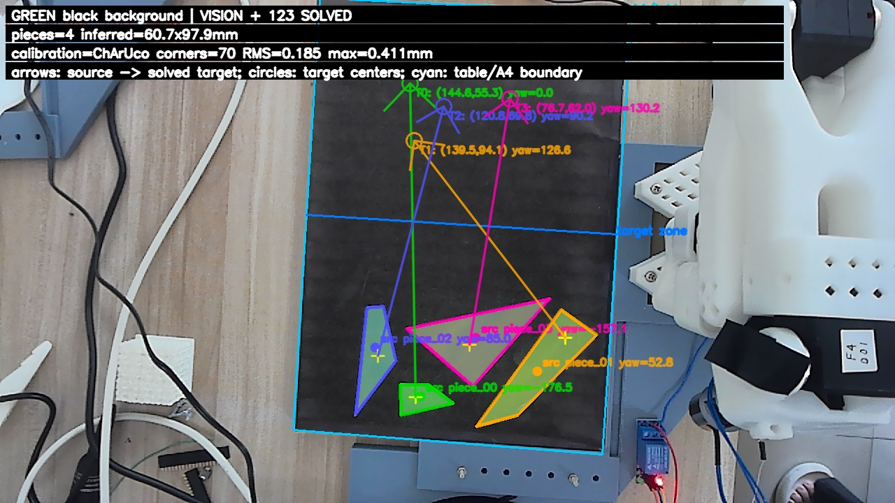

# puzzle-arm · 视觉引导五轴机械臂拼图系统

2026 年全国大学生电子设计竞赛 E 题「拼图装置」的参赛工作区（三人队）。顶置相机识别碎片并求解拼图，拆掉夹爪、改装电磁吸头的 SO-101 五轴机械臂完成抓放，全部运行在树莓派 5 上。

## 成果

- **视觉**：ChArUco 内参标定，单应变换到桌面毫米坐标；背景建模 + 多阈值投票分割、多边形拟合，输出碎片位姿和抓取点。标定 70 角点，RMS 0.185 mm，最大 0.411 mm。
- **求解**：基于边匹配的 SE(2) 位姿搜索，遇到歧义或超时显式拒绝，不输出猜测结果。
- **运动控制**：五轴 IK + 固定安全高度的分阶段抓放轨迹（HOME → SAFE → PREGRASP → PICK → PREPLACE → PLACE，另有 RECOVERY），逐步校验关节步长和速度，以舵机回读到位作为完成判据；上电流程失效即停，异常时自动断磁、卸力矩。
- **实机结果**：四片白色碎片拼成 100×60 mm 矩形，位置偏差 **1.0–3.6 mm**，旋转偏差 **≤1.4°**（[`docs/experiments/REPORT_HUMAN_v10.md`](docs/experiments/REPORT_HUMAN_v10.md)）。
- **学习策略**：ACT 模仿学习只负责末端几厘米的局部修正，可以随时退回纯 OpenCV + IK 路径。

没做成或还有风险的部分也都留在记录里：Pi 上 128 个测试中仍有 1 个失败、12 个错误（[`TEST_LOG.md`](docs/experiments/test_log_20260801/TEST_LOG.md)）；`wrist_roll` 跨越 ±180° 时路径无法收敛；机械臂运动时 USB 端口会掉线；目前没有吸附传感器，抓放成败需要现场目视确认。

## 与 AI Agent 的协作方式

代码由我和 Codex / Claude 等 Agent 协作完成，规则写在 [`AGENTS.md`](AGENTS.md)：

- **数据真实性**：测试数据只能来自日志，不能把估计值写成实测值；无法确认的硬件参数一律写 `UNKNOWN`。
- **模块边界**：vision 只输出观察，puzzle 只输出方案，control 负责 IK 和安全过滤，Supervisor 是唯一能切换全局状态的模块，ACT 必须能通过配置完全关闭。
- **硬件安全**：同一时刻只有一个主会话能下发硬件动作，子 Agent 只做只读分析和代码审查；运动前逐项检查运动锁、设备身份和自检结果；出现故障后建立持久运动锁，只有现场人工确认后才能解锁。
- **先定验收再实现**：接触高度、抓放成功率等都有验收文件，未通过时 fail-closed。`AGENTS.md` 后半部分记录了每次实机故障的根因（例如 USB 端口级掉线与 xHCI 控制器故障的区别、旋转方向约定），可以直接看出迭代过程。
- `.pi-subagents/artifacts/` 保留了研究员 / 审查员子 Agent 的输入与输出（完整的对话转录没有公开）。

## 分支

- `main`：最新版本（旋转 0° 基准、分档提速、5 mm 净距布局，以及发布时的工作区快照）
- `test/wrist-roll-pose-lock`：低高度抓放路径锁定腕部姿态的实验

## 公开版说明

赛题原文、LeRobot / ACT 论文、树莓派官方 PDF、镜像访问私钥和系统镜像盘点文件都已从历史中移除，赛题请以竞赛组委会发布的版本为准。

---

## 工作区说明

本工作区面向 2026 年电赛 E 题“拼图装置”。目标是在树莓派 5 8GB 上运行视觉、任务规划和机械臂执行；训练在独立 GPU 设备上完成。系统采用可降级架构：

1. OpenCV 与几何算法负责碎片识别、拼图求解和结果复核。
2. 传统逆运动学、关节轨迹和安全高度状态机负责全部可确定的大范围移动。
3. ACT 仅作为抓取/放置附近的局部视觉修正模块，不是主路径规划器，也不是拼图求解器。
4. 电磁铁由独立状态机控制，不进入 ACT 的动作维度。
5. 去掉夹爪舵机后的机械臂使用 5 维状态和 5 维动作训练，LeRobot 不要求完整 6 个电机。

## 阅读顺序

1. `docs/00_范围与冻结决策.md`
2. `docs/01_赛题需求追踪矩阵.md`
3. `docs/02_系统总体架构.md`
4. `docs/13_96小时执行计划.md`
5. 按个人分工阅读视觉、机械、控制、ACT 和测试文档。

## 第一原则

ACT 不是首日阻塞项。必须先完成以下基线：

`顶置相机 -> OpenCV 定位 -> 坐标标定 -> 5轴 IK/轨迹 -> 电磁铁抓放 -> 视觉复核`

只有基线已经能稳定完成单片抓放，且完整固定拼图流程可运行后，才接入 ACT 局部策略。ACT 失败时系统必须能立即退化到纯 OpenCV + IK 模式。

## 版本冻结

- LeRobot：`v0.6.0`
- LeRobot 稳定版发布日期：2026-07-06
- ACT 训练端：GPU 主机
- 推理端：Raspberry Pi 5 8GB，CPU 推理先做基准测试
- 赛题原文：`official_docs/competition/E题_拼图装置.pdf`

版本与官方来源见 `official_docs/INDEX.md` 和 `official_docs/sources.lock.json`。
